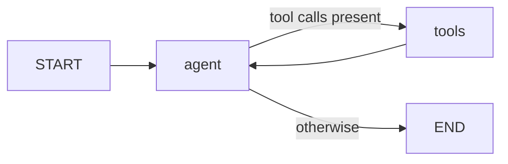

# AccountCare Support Agent

A LangGraph-based support assistant for subscriber billing and plan questions. It answers general questions directly and routes account-specific questions through validated tools, so the model never guesses account data.

## Project layout

```
main.py                 Graph, routing, tool execution, entry point
prompt.txt              System prompt (direct-answer vs tool judgment, user_id rules, escalation)
requirements.txt        Pinned dependencies
utils/account_tools.py  Tools (@tool wrappers) and TOOL_REGISTRY, plus sample accounts
utils/state.py          AgentState definition
tests/test_agent.py     Local tests using a stub model (no network)
```

## How it works



- **agent**: sends the system prompt plus the message history to the model.
- **route_after_model**: returns `"tools"` if the last message is an `AIMessage` with tool calls, else `"end"`. It executes nothing.
- **tools**: runs `execute_tool_calls` for every call in the turn, in order.
- **tools -> agent**: the model sees the results and either answers or calls another tool.

### Tool execution contract

Each call yields one `ToolMessage` preserving the call's `tool_call_id` and `name`, with JSON content:

| Situation | Content |
| --- | --- |
| Success | `{"ok": true, "output": <value>}` |
| Name not in registry (nothing is executed) | `{"ok": false, "error": "unknown_tool"}` |
| Handler raises any exception | `{"ok": false, "error": "tool_execution_failed"}` |

Raw exception text is never returned to the model or user.

### Tools

| Tool | Purpose |
| --- | --- |
| `check_subscription_status(user_id)` | Plan, status, renewal date |
| `calculate_refund_eligibility(user_id, days_since_purchase)` | Refund eligibility (within 14 days) and amount |
| `escalate_to_human(user_id, reason)` | Creates a local escalation ticket |

Sample accounts: `U-100` (Pro, active) and `U-200` (Basic, past_due).

### System prompt

`prompt.txt` instructs the model to:

1. Answer general, account-independent questions directly with no tool call.
2. Use a tool for every account-specific question and pick the matching one.
3. Ask for `user_id` (and days since purchase for refunds) instead of guessing when missing.
4. Escalate on explicit request, clear frustration, a disputed ineligible refund, or out-of-scope requests.
5. Report account facts only as returned by tools, and never expose internal errors.

## Setup

```powershell
python -m venv .venv
.venv\Scripts\Activate.ps1
pip install -r requirements.txt
pip install pytest
```

## Running the tests (no API key needed)

```powershell
python -m pytest tests -v
```

The tests use a deterministic stub model that returns scripted `AIMessage`s, and cover:

- Routing: tool calls vs plain reply vs non-AI message.
- Tool execution: success, unknown tool, exceptions (sanitized), bad arguments, multiple calls with preserved order/ids, empty list.
- Full graph: direct answer (one model call), tool round trip, chained tool calls, resilience to unknown tools and failures, system prompt sent first.
- Basic prompt sanity checks.

These verify the code, not the model's judgment; prompt quality needs a live run.

## Running against Groq

Create a `.env` file:

```
GROQ_API_KEY=your_key_here
GROQ_MODEL=openai/gpt-oss-120b   # optional
```

Then:

```powershell
python main.py
```

This runs four sample queries: a general question, a status check, a refund request, and an escalation request. Programmatic use:

```python
from main import run_agent
print(run_agent("What's the status of account U-100?"))
```

Do not commit `.env`.
